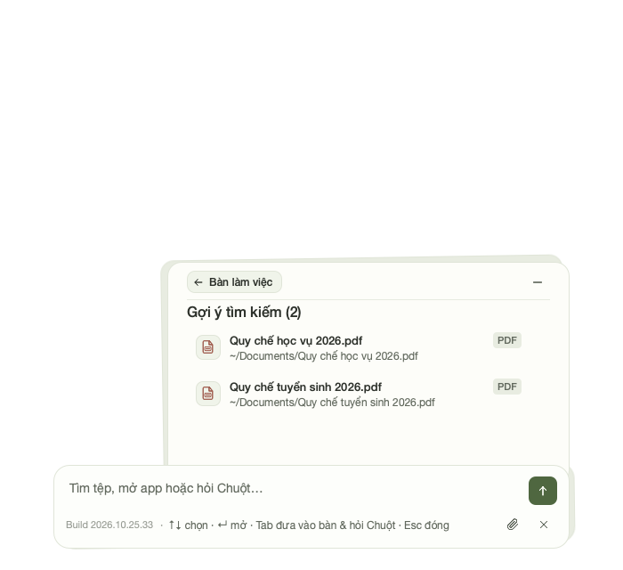
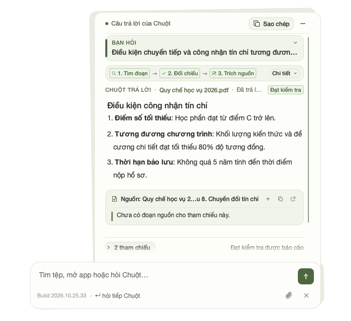
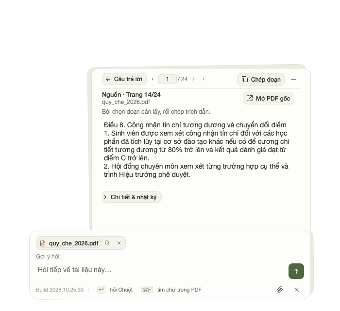

# Selective Delegation Agent

<p align="center">
  <strong>Local-first macOS assistant and document intelligence desk with selective delegation, contextual reasoning, and on-device privacy (powered by the RAT execution engine).</strong>
</p>

<p align="center">
  <a href="https://www.python.org/"></a>
  <a href="https://developer.apple.com/metal/"></a>
  <a href="https://www.riverbankcomputing.com/software/pyqt/"></a>
  <a href="https://github.com/ml-explore/mlx"></a>
</p>

---

## 1. Overview

**Selective Delegation Agent** is an on-device personal assistant and document intelligence desk designed for macOS. Instead of indiscriminately routing all interactions and documents to third-party cloud endpoints, the agent executes search indexing, document parsing, and reasoning locally on Apple Silicon, only delegating tasks when bounded verifiers and operational constraints require it.

The platform operates across two complementary environments:
- **Resident Desktop Shell (RAT)**: A background tray and hotkey-driven interface built on PyQt6 / Qt Quick for instant searching, PDF inspection, and application control.
- **Headless CLI & Kernel**: A modular command-line suite and reasoning kernel for automated indexing, offline Q&A, and diff reviews.

---

## Visual Preview

<p align="center">
  
  <br>
  <em>Instant Apple Spotlight-style hybrid search with semantic reranking and latency counters</em>
</p>

<p align="center">
  
  
  <br>
  <em>Left: Document inspection desk with page citations · Right: Local on-device assistant dialogue stream</em>
</p>

---

## 2. What RAT Actually Does

Unlike purely conversational chatbots or theoretical routing benchmarks, RAT integrates directly with your local workspace:

1. **True Hybrid Search (FTS5 + Dense Vectors)**: Indexes local folders and combines SQLite full-text search with vector embeddings via Reciprocal Rank Fusion (RRF) and HyDE query expansion.
2. **Deep Document & PDF Intelligence**: Extracts text, page evidence, and structured excerpts from local PDFs, DOCX, and source trees without uploading them to external servers.
3. **Local SLM Inference**: Executes small language models (such as Qwen 2.5) locally using native MLX on Apple Silicon for zero-cost, offline question answering.
4. **Desktop Automation & System Integration**: Global hotkey activation, macOS Application bundle resolver, and verified system launch workflows.
5. **Headless Code Review & Diagnostics**: Multi-lens diff inspection (missing imports, boundary invariants, code hygiene) and deterministic execution verifiers.

---

## 3. Architecture

```
RAT Runtime Architecture
│
├── rat/os/               Desktop Resident & System Layer
│   ├── app.py            ResidentApplication lifecycle, tray, and event loop
│   ├── crash_shield.py   Global exception protection and crash recovery
│   └── diagnostics.py    Isolated state verification and telemetry
│
├── rat/ui/               Presentation Layer (PyQt6 & Qt Quick)
│   ├── quick_app.py      Quick desktop launcher and application entry
│   ├── quick/            Modular Qt Quick views (Desk, Paper, Mascot, Settings)
│   └── quick_pdf_controller.py  State management and document controller
│
├── rat/engine/           Intelligence & Reasoning Engine
│   ├── hybrid_search.py  FTS5 + vector embedding search via RRF
│   ├── slm.py            Local SLM management and inference
│   ├── mlx_document_session.py  Native Apple Silicon MLX chat runtime
│   └── verification.py   Deterministic operation checkers and verifiers
│
├── rat/crawler/          Filesystem & Storage
│   ├── indexer.py        Document intake, hashing, and chunking
│   └── db.py             SQLite database and FTS5 full-text storage
│
└── rat/kernel/           Modular Capability & Tool Contracts
    ├── registry.py       Capability and OperationDefinition registry
    └── capabilities/     Documents, Applications, Finder, Code Review
```

---

## 4. Privacy & Data Boundaries

* **Local-First Processing**: Document indexing, vector generation, and search queries execute entirely on your machine. No telemetry or personal documents are transmitted to external servers by default.
* **Conditional Escalation**: When optional external models or web lookups are explicitly enabled by the user, only the selected task snippet is sent to the configured provider.
* **Bounded Verifiers**: Operational verifiers run deterministically on local data (AST evaluation, schema validation, evidence matching). They provide reproducible validation for explicitly supported constraints rather than speculative scoring.

---

## 5. Getting Started

### Prerequisites
- **macOS** (Optimized for Apple Silicon: M1 / M2 / M3 / M4)
- **Python 3.11+**
- Package manager: [`uv`](https://github.com/astral-sh/uv) (the lock file is the only dependency source)

### Installation

```bash
# Clone repository
git clone https://github.com/Thundercok/selective-delegation-agent.git
cd selective-delegation-agent

# Install the pinned dependencies from uv.lock
uv sync
```

---

## 6. Usage

If using `uv`, you can prefix commands with `uv run` (or activate `.venv` with `source .venv/bin/activate`).

### Launch Desktop Application (GUI)

```bash
# Launch default Unified Qt Quick Desk
uv run python main.py
# (or: python3 main.py with .venv active)

# Launch Quick PDF inspection mode
uv run python main.py quick-pdf
```

### CLI Commands

```bash
# Index configured directories
uv run python main.py index

# Natural language hybrid search
uv run python main.py search "báo cáo tài chính quý 3"

# Query local SLM about an indexed document
python3 main.py ask "contract_2026.pdf" "What are the payment terms?"

# Offline chat with a specific file using local MLX model
python3 main.py ask-file /path/to/doc.pdf --model-path /path/to/mlx-model

# Detect duplicate files and document revision trees
python3 main.py dedup

# Multi-lens automated code review (local diff or GitHub PR)
python3 main.py review
python3 main.py review 5 --repo owner/repo

# Check indexing and SLM engine status
python3 main.py status
```

---

## 7. Testing & Reliability

The test suite covers unit logic, contract schemas, and isolated diagnostic states:

```bash
# Run task memory and capability tests
uv run pytest tests/test_rat_task_memory.py tests/test_code_review_capability.py

# Run verification suite
uv run pytest tests/test_rat_verification.py
```

---

## 8. Current Scope & Known Limitations

- **Platform Specifics**: Resident background integration and hotkeys currently target macOS. Linux and Windows run primarily in headless / CLI mode.
- **Model Hardware Bounds**: Local MLX inference speed depends on unified memory bandwidth; 16GB+ RAM is recommended for 7B+ parameter models.
- **Active Refactoring**: Work is underway to further decouple `rat/main.py` bootstrap routing from the `ResidentApplication` lifecycle.

---

## 9. Roadmap

- [ ] Complete profile configuration to eliminate hardcoded user preferences in CLI.
- [ ] Decouple resident background watcher lifecycle from UI presentation.
- [ ] Export standardized diagnostic health reports with JSON schema validation.
- [ ] Expand standalone cross-platform CLI capabilities.
