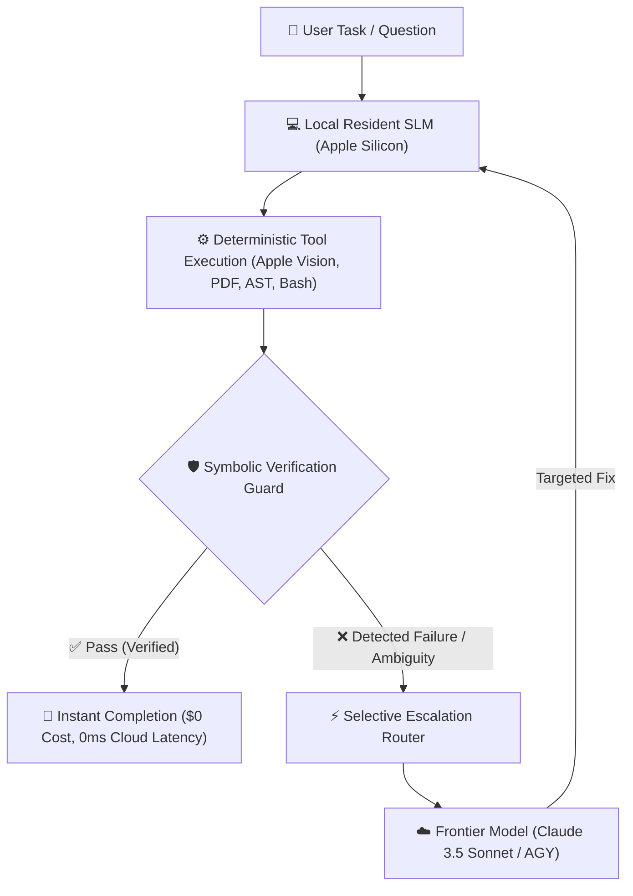

<p align="center">
  <strong>An On-Device Resident Agent that Solves Everyday Tasks for $0 and Dynamically Escalates to Claude When Stuck.</strong>
</p>

<p align="center">
  <a href="https://github.com/Thundercok/selective-delegation-agent/stargazers"></a>
  <a href="https://github.com/Thundercok/selective-delegation-agent/blob/main/LICENSE"></a>
  <a href="https://www.python.org/"></a>
  <a href="https://developer.apple.com/metal/"></a>
</p>

---

## ⚡ The Core Problem: Why Pay for Cloud When You Don't Have To?

Existing cascading architectures like **FrugalGPT** (Stanford) and **AutoMix** evaluate static prompt routing on benchmark question-answering datasets. Meanwhile, developer coding agents (like Aider or OpenHands) either send every keystroke to expensive cloud APIs or rigidly split tasks upfront.

**CHUOT (`selective-delegation-agent`) takes a different approach: Deterministic-Guarded Multi-Step Execution.**

* **Local by Default ($0 / Zero Data Leakage)**: Runs on consumer hardware (Mac Apple Silicon) to inspect files, index documents, parse PDFs, and execute local tools.
* **Deterministic Guards, Not LLM Judges**: Instead of paying another LLM to score whether the first LLM was right, CHUOT relies on **symbolic, deterministic verifiers** (linters, AST parsers, regex math checks, test suites) to spot failures with 100% precision.
* **Selective Escalation**: When and only when a deterministic guard fails or local certainty falls below threshold, CHUOT packages the exact bottleneck state and escalates it to frontier models (**Claude / Antigravity**).

---

## 🥊 Competitive Landscape

| Capability | FrugalGPT / AutoMix | Cloud Coding Agents (Aider, etc.) | **CHUOT (`selective-delegation`)** |
| :--- | :---: | :---: | :---: |
| **Execution Realm** | Static QA (MMLU / TriviaQA) | Cloud-only Multi-turn | **On-Device OS & Filesystem** |
| **Verification Method** | LLM scoring LLM *(hallucinates)* | Human in the loop | **Deterministic / Symbolic Guards** |
| **Cost Profile** | Cloud router + Cloud models | 100% Cloud API bills | **$0 Local Default, Pay Only on Escalation** |
| **Data Privacy** | All prompts sent to Cloud | Code sent to Cloud | **Local by default; sanitized escalation** |
| **Hardware** | Datacenter GPUs | Local client, Cloud compute | **Optimized for Apple Silicon (M1/M2/M3)** |

---

## 🏗️ Architecture



---

## 🚀 Features

- **🛡️ Zero-Hallucination Symbolic Guards**: Uses code-level deterministic verification (Python AST, format checkers, and execution tests) rather than probabilistic LLM self-evaluation.
- **⚡ Resident Desktop Integration**: Instant hotkey access, local semantic hybrid search (BM25 + Dense RRF), native Apple Vision OCR, and local translation.
- **📁 Document Intake Engine**: Blazing fast intake and chunking of complex PDFs, course materials, and local files directly into an indexed SQLite/vector store.
- **🎛️ Dynamic Escalation Protocol**: Keeps prompt tokens lean by only delegating sub-problems that require deep reasoning to Claude.

---

## 📦 Quickstart

### 1. Prerequisites
- macOS (Apple Silicon M-series recommended)
- Python 3.11+

### 2. Installation
```bash
git clone https://github.com/Thundercok/selective-delegation-agent.git
cd selective-delegation-agent

python3 -m venv .venv
source .venv/bin/activate
pip install -r requirements.txt
```

### 3. Verify Test Suite
Run the 105 pre-registered architecture and component tests:
```bash
pytest tests/
```

### 4. Run CHUOT Desktop
```bash
python main.py
```

---

## 📚 Scientific Grounding

This project bridges empirical agent routing with formal verification research:
- **Mechanistic Faithfulness**: Validated on load-bearing reasoning traces from [`multi-step-structured-reasoning`](https://github.com/Thundercok/multi-step-structured-reasoning).
- **Cost-Constrained Execution**: Inspired by FrugalGPT (Chen et al., 2023) and AutoMix (Khattab et al., 2024), extending the frontier from single-turn QA to multi-step desktop agent workflows.

